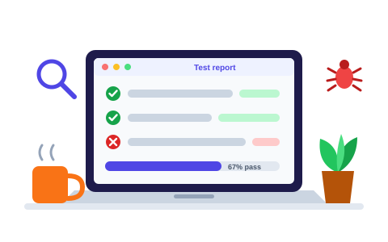
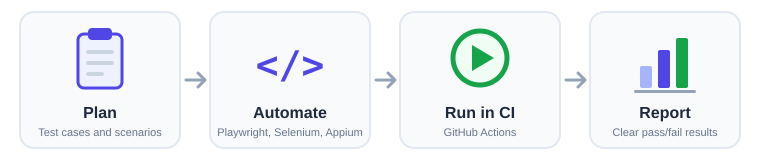

<h1 align="center">Hi 👋, I'm Zobayda Akter</h1>
<h3 align="center">QA Automation Engineer from Bangladesh</h3>

  

  

- 🔭 I'm currently working on test automation for a Salesforce-based mobile platform
- 💬 Ask me about test automation, API testing and mobile testing
- 📫 How to reach me: [zobayda.akter18@gmail.com](mailto:zobayda.akter18@gmail.com)

### Connect with me

  

### Languages and Tools

  

Also: Playwright · Appium · Rest Assured · k6 · SQL · Oracle · GitHub Actions

### How I work

  

### Projects
- [UI-API-Test-Automation-Framework](https://github.com/zobaydadev/UI-API-Test-Automation-Framework): Selenium, TestNG, Rest Assured
- [BookingHub-API-Test-Suite](https://github.com/zobaydadev/BookingHub-API-Test-Suite): REST API tests with Rest Assured
- [ShopFlow-E2E-Playwright-Tests](https://github.com/zobaydadev/ShopFlow-E2E-Playwright-Tests): Playwright with TypeScript
- [LoadLens-K6-Performance-Suite](https://github.com/zobaydadev/LoadLens-K6-Performance-Suite): k6 performance tests
